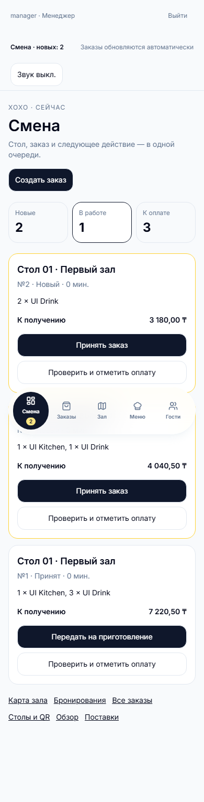
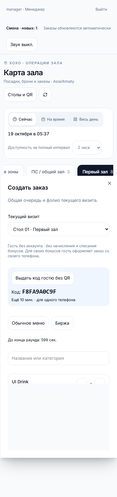
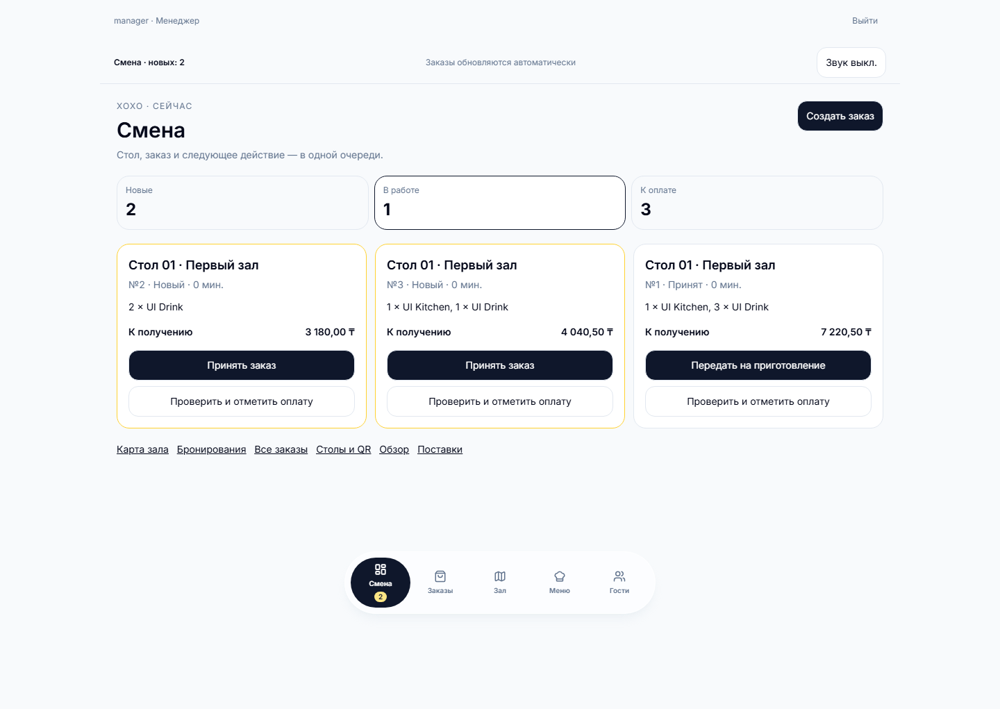

# Service Operations 3 — acceptance and evidence

Date: 2026-10-19. This extends the existing production system, not a replacement POS.

## Audit and dependency map

Baselines: Command Center `9adac4e2c8de5b71f614540c031977b22c21175b`, Hostess `d8d0d911a060f06dbb7a686509efd9d14a5507ae`, XOXO `d232da7ce27b6155e7e399b87fafa68cf3ca22ac`. Both primary local branches matched GitHub main. Hostess's untracked `src/images-bar-xoxo/` was preserved in its original checkout; implementation uses separate worktrees.

| Capability at audit                                  | State                                      | Source of truth / change                                                   |
| ---------------------------------------------------- | ------------------------------------------ | -------------------------------------------------------------------------- |
| Booking availability, holds, idempotent reservations | Working                                    | Existing normalized inventory and canonical reservations reused            |
| QR checkout and mixed menu                           | Working                                    | Existing quotes/orders/immutable line snapshots reused                     |
| Visit lifecycle and folio                            | Working                                    | Existing dining_sessions, floor serialization, per-visit totals reused     |
| Staff service transitions and manual payment         | Working                                    | Existing row locks, sequential transitions, audit and payment marks reused |
| Staff order creation                                 | Missing                                    | Visit-bound staff quote/checkout extends the same financial pipeline       |
| Orders polling and sound                             | Partial, orders page only                  | Moved to shared authenticated AppShell provider                            |
| Priority service queue                               | Missing                                    | /shift reads durable order state, prioritizes oldest new orders            |
| No-QR checkout                                       | Missing                                    | Staff-issued, owner-bound temporary visit capability                       |
| Unconfigured-inventory booking fallback              | Missing                                    | Non-allocating request, manager confirmation creates canonical reservation |
| Regular-menu booking preorders                       | Missing                                    | Existing booking quote/preorder rows extended with source type             |
| Guest order status                                   | UX gap, receipt used generic accepted text | Human labels and receipt polling in Hostess                                |

PostgreSQL remains the authority for inventory, visits, reservations, all orders, loyalty and outbox. Hostess remains the guest UI/BFF. XOXO remains the exchange catalog, round, price and demand authority. There is no staff order ledger, second wallet, parallel reservation ledger or browser-side sale delivery.

## Operations

Open **Смена** from the bottom navigation or global status strip. The persistent queue contains new orders, active service and closed orders without a manual payment mark. Global counts are server aggregates, not a client seen set. Toast dismissal does not accept an order. Reload/reconnect recovers pending tasks from server state. More than 200 tasks is explicitly indicated; use the searchable orders screen for the remainder.

Cards show table/zone, age, immutable line amounts, payable and the next valid service action. Arrival warnings use existing floor reservations and do not release an occupied table. There is no invented timed readiness state.

Staff composer is available from Shift, Orders, table drawer and open folio. Confirm seating on the existing floor screen first for walk-ins. Choose published regular dishes and current exchange products, request a server quote, then explicitly confirm. Changed/expired prices require another calculation. A pending checkout stores its exact quote/key before submission and recovers after reload; an uncertain response only retries that attempt.

Anonymous staff orders earn/redeem nothing. Optional loyalty is derived exclusively from the current seated visit's guest matching its **arrived canonical reservation** and an existing verified WhatsApp identity. Typing a phone or merely assigning a guest to a visit cannot select a wallet. Checkout revalidates this relationship. FIFO redemption, 3% cashback, 14-day expiry, immutable entries and manager cancellation compensation use existing services. The user can also order from their own phone for their own bonuses.

All sources use one session/order/folio and the same outbox. Order creation records staff actor or `qr`/`table_code` source. Exchange lines alone emit ORDER_ACCEPTED; regular dishes never enter demand and no manual bartender sale is created. Manual payment retains the existing exact order payable, staff actor/time and audit. `assumed_paid` remains the pilot convention, not bank settlement.

## Temporary no-QR access

After physically checking presence and seating, staff opens the composer and issues a code. A random 40-bit code lasts ten minutes, serves one owner session and references that visit. Reissuing revokes the previous unused code. Successful claim retries by the same owner return the same temporary capability; another owner cannot claim it. All claims are rate-limited by the existing trusted BFF client identifier and by owner. Issuance is staff/origin protected, rate-limited and audited.

The guest enters the code on XOXO, receives an owner-bound temporary capability and uses the existing DiningPage/cart/quotes/checkout. Permanent QR tokens are never returned by this flow. Quote and checkout validate active confirmed seating; expiry, revocation or visit release blocks new orders. Retrying a checkout that already committed still returns the original order after release. Code claim itself creates no order, payment, cashback or exchange event.

## Booking requests

If no automatically confirmable place is selected, Hostess offers **Оставить заявку на бронирование** after normal guest bootstrap/consent. A request allocates no inventory and is honestly pending. Its random idempotency key, payload signature and transaction lock prevent duplicate timeout/double-click submissions. Rate limits and a maximum of three pending requests constrain abuse. Guests see their own requests in their cabinet; verified identity merges preserve request ownership.

Staff sees requests on Shift. Only manager can confirm or reject, matching existing reservation permissions. Confirmation locks the request and floor, reuses `selectReservableResource`, creates one canonical confirmed reservation and normalized resource link in the same transaction. Concurrent confirmations return that reservation. No unknown capacity or physical mapping is made bookable. Staff can contact the guest using the existing contact context for alternatives.

## Database and security

Migration `0011_service_operations.sql` adds access grants and booking requests, quote visit/staff/grant metadata, and preorder item type. Booking quote round becomes nullable for a regular-only preorder. Existing identifiers, inventory, QR tokens, layouts, bookings, accepted amounts and financial history are not updated by this migration.

Viewer reads; operator and manager create/service orders, mark payment and issue visit codes; only manager resolves booking requests, edits menu/inventory, rotates QR or cancels financially. Existing staff sessions, exact Origin, BFF service key, owner/receipt isolation, parameter validation, rate limiting and audit are preserved. No credentials enter public bundles.

## Verification

- Typecheck, lint and production build: pass locally. Lint warnings in existing shared UI remain; no lint errors.
- Existing unit suite: 41 passing tests.
- PostgreSQL dining suite: 47 passing, one optional older sibling-schema test skipped; the replacement real cross-service HTTP run below was executed separately.
- Full local integration suites: booking, dining, physical registry, floor operations and clean migration/replay. The replay preserves all 17 QR tokens in the isolated database.
- New PostgreSQL checks cover staff mixed checkout/replay/actor/visit, no-QR ownership/expiry/release, two-employee transitions/payment, request concurrency and protected verified guest loyalty.
- Browser: real Command Center server + isolated PostgreSQL, Chromium 320/375/390/430/768/1024/1440 composer, existing floor/order/folio/registry scenarios, and WebKit. Existing wheel tests now operate the actual accessible spinbuttons; pinch testing checks intentional zoomed canvas panning and restored vertical scrolling after reset.
- Actual HTTP Hostess BFF → Command Center → local PostgreSQL → actual XOXO routes/Prisma: pass for staff and no-QR mixed orders, duplicate checkout, guest status roundtrip, common visit, 8 accepted/cancelled receiver events, no manual exchange sales and zero net demand after compensation. No mocked fetch was used in this cross-service run. UI guest fixtures are separately labeled as fixture tests.

For reproducibility use `npm run test:cross` with `XOXO_SOURCE_ROOT`, `HOSTESS_SOURCE_ROOT`, and fresh dedicated local `hostess_test` databases named `xoxo_cross_test` and `command_cross_test`. `scripts/test-service-cross.mjs` rejects non-local/non-test URLs, runs XOXO's migrations and the actual route/service test in `tests/service-cross.http.ts`. It never resets a database.

Screenshots are isolated fixture data, not real guest activity:

## Production evidence and limits

Before rollout, both `https://admin.hostes.online/health` and the Railway origin returned 200 with database healthy. The custom domain has a valid Railway certificate and responds over HTTPS despite Railway's inconsistent DNS diagnostic. Origin configuration is preserved.

Read-only production inventory counts: First hall 8, Second hall 3, PS 3, VIP 3, total 17. An approved server-only in-memory before/after comparison confirmed that all 17 QR credentials, generations, physical zone assignments and persisted layouts survived migration unchanged. No tokens or credential-derived hashes were exported. See [delivery evidence](SERVICE_EXPERIENCE_3_DELIVERY.md).

Railway native backup created before migration: `1c7f9096-9543-404e-9711-2684fcabc9ea`, 2026-10-19T00:26:50.119Z, “Before service experience 3 additive migration”. Credentials were not exported. This is a native snapshot confirmation, not a claimed production restore rehearsal. No real guest test orders/reservations/loyalty writes were made.

CI, PR, merge and final deployment evidence are recorded in the delivery addendum after rollout. No push notifications while the browser is closed are promised. Quote validity remains bounded by the exchange round; expired visit codes require reissue. Unconfirmed physical inventory remains unavailable until the owner verifies it.

## UX references

[Toast KDS](https://support.toasttab.com/en/article/Get-Started-With-the-Kitchen-Display-System) informed clear ticket age and next actions; [Lightspeed floor plans](https://k-series-support.lightspeedhq.com/hc/en-us/articles/1260804656709-Creating-and-managing-floor-plans-and-tables) informed table-to-service context; [Square KDS](https://api.squareup.com/help/us/en/article/8171-complete-orders-with-square-kds) informed keeping service completion separate from payment. No full POS/KDS or new pricing algorithm was introduced.
